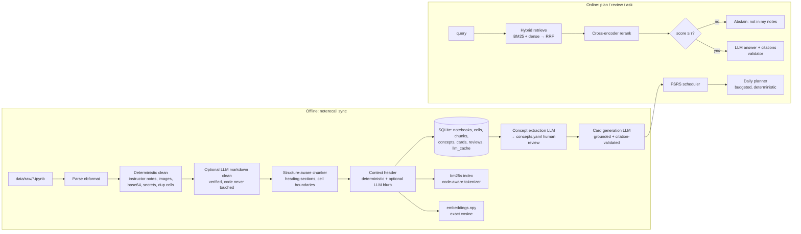

# NoteRecall — Architecture & Build Plan

> Working name. Alternatives: **Revisely**, **Groundwork**, **NotebookRecall**. Rename freely; the package name below is `noterecall`.

**One-line pitch:** A revision planner that turns my own ~53 Colab notebooks into grounded flashcards and a daily study plan. Retrieval is hybrid (BM25 + dense + rerank), every generated card cites the notebook cells it came from, and scheduling is done by a published memory model (FSRS), not by the LLM.

**Why it is not an agent (say this in the interview):** The control flow is fixed and testable. The LLM is called at exactly four bounded points (optional contextual blurbs, concept extraction, card generation, Q&A answer) and always returns schema-validated JSON. Every decision that can be made by an algorithm (what to retrieve, what to review today, how to rank) is made by an algorithm. This makes the system measurable, cheap, and debuggable.

---

## 0. Assumptions (change these before the agent starts, not after)

| # | Assumption | If wrong |
|---|---|---|
| A1 | Notebooks live outside the repo (`data/raw/`, git-ignored). Only small synthetic fixture notebooks are committed. | If you want them in the repo, keep them in a private repo anyway. |
| A2 | LLM = Anthropic API (Claude), model names in config only. Embeddings + reranker run locally (sentence-transformers, CPU). | Swap the `LLMClient` implementation; nothing else changes. |
| A3 | Single user, local machine, CLI-first. FastAPI is a thin layer added last. | — |
| A4 | Sync is run manually (`noterecall sync`), never on a watcher. | — |
| A5 | Later sources (handwritten notes, PDFs, slides) are **out of scope** for v1 but must plug in through the `SourceLoader` protocol. | — |
| A6 | **You (Jayesh) write the gold evaluation set by hand.** The agent builds the labelling tool; it never authors or edits labels. | Non-negotiable — see ADR-009. |

---

## 1. Architecture



### Module layout (fixed)

```
src/noterecall/
  config.py              pydantic-settings; reads config/default.toml + env
  models.py              domain models: Notebook, Cell, Chunk, Concept, Card, Review, RetrievalHit
  ingest/
    loader.py            SourceLoader Protocol (future: pdf, handwritten)
    ipynb.py             nbformat parsing → Cell list (markdown/code/text-output)
    clean.py             deterministic cleaning rules (config/cleaning_rules.yaml)
    secrets.py           secret scrubbing (API keys, AWS keys, tokens)
    llm_clean.py         optional markdown-only LLM clean + verifier
    sync.py              content-hash incremental sync
  chunking/
    structural.py        heading-section chunker (production)
    fixed.py             fixed-token chunker (baseline for ablation only)
    tokens.py            token counting (one tokenizer, used everywhere)
  index/
    store.py             SQLite schema + repository functions
    embeddings.py        embedding model wrapper + content-hash cache
    lexical.py           bm25s index build/load
    code_tokenizer.py    snake_case / camelCase / dotted-path aware tokenizer
  retrieval/
    dense.py  lexical_search.py  fusion.py (RRF)  rerank.py  pipeline.py
  enrich/
    headers.py           deterministic "notebook > H1 > H2" header
    contextual.py        LLM contextual blurb (Anthropic Contextual Retrieval style)
  llm/
    client.py            LLMClient Protocol: complete_json(prompt, schema) -> model
    anthropic_client.py  real client, prompt caching, retries, token/cost logging
    fake.py              deterministic fake for tests (replays fixtures)
    cache.py             key = sha256(model, prompt_version, input)
    prompts/*.md         versioned prompt files; version = file hash
  generate/
    citations.py         citation validator (the core anti-hallucination gate)
    answer.py  concepts.py  cards.py
  srs/
    clock.py             injectable clock (UTC)
    scheduler.py         thin wrapper over the `fsrs` package
    planner.py           daily plan: due-first, budgeted, deterministic
  eval/
    gold.py              gold set schema, loader, validator (orphan labels)
    metrics.py           Recall@k, MRR@k, nDCG@k, recall@token-budget
    stats.py             paired bootstrap CI, permutation test
    run_retrieval.py     ablation runner → results/*.json
    run_generation.py    citation validity, faithfulness, abstention F1
    judge.py             LLM judge + human-agreement calibration
  cli.py                 Typer: sync, label, eval, ask, cards, review, plan
  api.py                 FastAPI (M9 only)
experiments/             one YAML per ablation config
results/                 committed JSON metric outputs (metrics only, no note content)
docs/adr/                one file per ADR below (copied verbatim from §2)
docs/proposals/          where the agent writes change requests
tests/unit  tests/property  tests/integration  tests/fixtures/notebooks/
```

---

## 2. Architecture Decision Records (LOCKED)

Each ADR has: the decision, the evidence, and — where a parameter is **data-decided** — the exact experiment that decides it. The agent may run those experiments and fill in the result. It may **not** change the decision or the decision rule.

### ADR-001 — Pipeline, not agent
LLM calls are fixed steps returning schema-validated JSON. No tool-calling loops, no LLM-chosen control flow. *Evidence:* deterministic pipelines are testable stage by stage; this is a single-user retrieval problem with no open-ended action space.

### ADR-002 — No LangChain / LlamaIndex / RAG frameworks
Hand-written retrieval, fusion and prompting (~a few hundred lines). *Reason:* every line must be explainable in an interview, and the ablations in ADR-010 need direct control over each stage. Allowed libraries are listed in §5.

### ADR-003 — Two-stage cleaning: deterministic first, LLM optional and verified
- Deterministic (always on): drop image/HTML/base64 outputs; truncate text outputs to N lines; drop empty cells; remove instructor-note cells/blocks via rules in `config/cleaning_rules.yaml` (rule-based, never LLM); scrub secrets; mark exact-duplicate cells across notebooks.
- LLM clean (optional, **markdown cells only**): fixes headings/typos. Verifier rejects output if any identifier/inline-code token from the original is missing, if length ratio leaves [0.7, 1.3], or if a code fence changed. Raw and cleaned text are both stored.
- **Data-decided:** LLM clean is ON only if it improves dev Recall@10 under the ADR-010 rule. Otherwise it ships OFF and that negative result goes in the README.

### ADR-004 — Structure-aware chunking on cell boundaries
A chunk = a markdown heading section and its following cells, split on **cell boundaries** when over the token cap; a single oversized code cell is split at blank lines / top-level `def`/`class`. Code and the markdown that explains it stay together. Code cells are never split mid-statement.
*Evidence:* Chroma's chunking study found splitter choice moves recall by several points and that simple structure-respecting splitters are competitive with LLM-based ones; a 2026 taxonomy paper (arXiv 2602.16974) found simple structure-based methods beat LLM-guided chunking for in-corpus retrieval. Notebooks have explicit structure — use it.
**Data-decided:** token cap ∈ {256, 512, 1024}; compared against the fixed-token baseline **at equal retrieved-token budget** (bigger chunks trivially inflate Recall@k).

### ADR-005 — Hybrid retrieval: BM25 + dense, fused with RRF
*Evidence:* BEIR showed BM25 is a robust zero-shot baseline that many dense models fail to beat out of domain; BM25 and dense fail on different queries (identifiers like `train_test_split` vs paraphrases). RRF (Cormack, Clarke & Büttcher, SIGIR 2009) fuses on ranks, so incomparable score scales don't matter.
- BM25 uses a **code-aware tokenizer** (`df.groupby` → `df`, `groupby`, `df.groupby`; `trainTestSplit`/`train_test_split` → parts + whole).
- **Data-decided:** RRF k ∈ {10, 30, 60}, default 60 (k=60 is a TREC-fit default, not a law; small two-list fusions often prefer lower k). Embedding model chosen from 2–3 candidates (e.g. a `bge-small`/`bge-base` class model and one alternative) — the agent must confirm each exists on Hugging Face and record exact revision hashes.

### ADR-006 — Cross-encoder reranking of the fused top-30
*Evidence:* Anthropic's Contextual Retrieval report: contextual embeddings + contextual BM25 cut top-20 retrieval failures by 49%, and adding reranking took it to 67% (5.7% → 1.9%).
**Data-decided:** reranker must beat no-reranker on dev under the ADR-010 rule **and** stay within the latency budget (§6). If it fails, it ships off and that is reported.

### ADR-007 — Context headers: deterministic always, LLM blurb data-decided
Every chunk is indexed (both BM25 and dense) with `"{notebook title} > {H1} > {H2}"` prepended. The LLM contextual blurb (Anthropic's method, with prompt caching on the notebook) is an ablation. Hypothesis to test: for well-structured notebooks the free deterministic header captures most of the gain. Either outcome is a good interview story.

### ADR-008 — Storage: SQLite + NumPy exact search, no vector DB
Corpus is ~53 notebooks → low thousands of chunks. Exact cosine over a few thousand vectors is a single matrix multiply (milliseconds) with perfect recall; an ANN index adds approximation error and ops cost for zero benefit. SQLite holds everything else (one file, transactional, inspectable). **Revisit trigger:** > 200k chunks or p95 dense search > 50 ms → FAISS/HNSW. Write this trigger in the README.

### ADR-009 — Gold set is human-written, cell-level, with a frozen test split
- ≥ 60 queries written by Jayesh, stratified: concept, code-identifier, "how did I…", cross-notebook, and **≥ 10% unanswerable** (not in the notes).
- Relevance is labelled at the **cell level** (`notebook_path` + cell content hash), never chunk ID. A chunk is relevant if it contains a relevant cell. This keeps labels valid across chunking ablations.
- Split 70/30 dev/test, fixed once, stratified by type. All tuning on dev. Test is run **once per milestone** and reported as-is.
- *Why human:* Chroma's own write-up notes LLM-generated eval questions lack diversity; a model grading retrieval on questions it invented is circular.
- `noterecall gold validate` reports labels whose cells no longer exist (after notebook edits).

### ADR-010 — Pre-registered decision rule for every ablation
For component X vs baseline: compute per-query metric deltas on **dev**, paired bootstrap (10,000 resamples) 95% CI. Adopt X if the CI lower bound > 0, **or** if X is free (no latency/cost) and the CI includes 0 with a non-negative mean. Then run the chosen config once on test. With ~60 queries, differences of a couple of points are often noise — the CI is what makes the claim defensible.
Primary metric: **Recall@10** (planner/card generation needs the right material in context). Secondary: nDCG@10, MRR@10, Recall@token-budget.

### ADR-011 — Grounding is enforced in code, not requested in the prompt
- Retrieved chunks are passed with short IDs (`[C3]`). Output schema requires `citations: list[str]` per claim/card.
- `citations.py` rejects any ID not in the provided context, any card with zero citations, and any answer whose claims are uncited. One retry with the error message; then drop (cards) or abstain (answers). Dropped counts are logged and reported.
- **Abstention:** if top reranker score < τ, return "not in your notes" without calling the LLM. τ is calibrated on dev to maximise answer/abstain F1 using the unanswerable queries.
- At most 6 chunks in context, highest-ranked first. *Evidence:* "Lost in the Middle" (Liu et al., TACL 2024) — models use information at the start/end of context far better than the middle; fewer, better chunks beat many marginal ones.

### ADR-012 — Generation evaluation with a calibrated judge
- Deterministic metrics first: citation validity rate, uncited-claim rate, abstention precision/recall.
- Faithfulness: LLM judge labels each claim supported/unsupported against **only** its cited chunks, binary, pointwise (no pairwise → no position bias). Use a **different model** from the generator where possible (self-preference bias, Zheng et al. 2023).
- Calibrate the judge: Jayesh hand-labels 30 claims; report judge–human agreement (Cohen's κ). If κ < 0.6, the judge number is not reported as a headline metric.

### ADR-013 — Scheduling by FSRS, planning by a deterministic algorithm
- Each card has an FSRS state via the official `fsrs` Python package (py-fsrs, FSRS-6 generation; UTC only; `Scheduler`, `Card`, `Rating`, `ReviewLog`). Fuzzing disabled in tests. *Evidence:* the open-spaced-repetition benchmark (hundreds of millions of Anki reviews) shows FSRS predicting recall better than SM-2 for the large majority of users, even with default parameters.
- **The user rates recall (Again/Hard/Good/Easy).** An LLM may *suggest* a rating for a typed answer; the user confirms. The LLM never writes to scheduler state.
- Planner: inputs = date, minutes budget, interview date. Order: overdue cards by lowest retrievability → due cards → new cards from lowest-mastery concepts (mastery = mean retrievability of a concept's reviewed cards) → stop at budget. Ties broken by card ID. Pure function of (state, clock, config).

### ADR-014 — Concepts are extracted by LLM but owned by the human
Per notebook, the LLM proposes concepts with evidence cell hashes. Near-duplicates are merged by embedding similarity above a threshold, written to `concepts.yaml`, which the user edits (rename, merge, delete, set priority 1–3). Downstream steps read only the reviewed file.

### ADR-015 — Reproducibility & caching
Every LLM call cached on `sha256(model, prompt_version, inputs)`; embeddings cached on `sha256(model_revision, text)`. Prompt files are versioned by content hash. Config + model revisions + git SHA are written into every `results/*.json`. Re-running `make eval` with a warm cache must reproduce numbers exactly.

---

## 3. Milestones (one PR each; acceptance criteria are hard gates)

| M | Scope | Acceptance criteria |
|---|---|---|
| **M0** Scaffold | uv project, layout, Makefile, CI (ruff, mypy --strict, pytest, coverage, banned-pattern check), config loading, 4–5 synthetic fixture notebooks (no headings; deep headings; huge output; image output; duplicate cells; fake secret) | CI green; `make check` passes; banned-pattern check demonstrably fails on a planted `TODO` in a throwaway commit |
| **M1** Ingest + deterministic clean + sync | ipynb parser, cleaning rules, secret scrub, SQLite store, hash-based incremental sync, `noterecall stats` | Unit tests per rule; secret fixture never reaches DB; re-sync of unchanged corpus does 0 writes; stats report (notebooks, cells, tokens, removed-by-rule counts) written to `results/corpus_stats.json` |
| **M2** Chunking | structural chunker + fixed baseline | Property tests (hypothesis): every retained cell appears in exactly one chunk; no chunk over cap unless it's one indivisible line; same input → same chunk IDs; code fence never split |
| **M3** Gold set tooling + eval harness | `noterecall label` (search → mark relevant cells), gold schema/validator, metrics, bootstrap | Metrics tested against hand-computed cases; bootstrap tested on synthetic data with known effect. **Stop here until Jayesh finishes the gold set.** |
| **M4** Retrieval | code tokenizer, BM25, dense (candidates), RRF, reranker, ablation runner | Ablation table in `results/retrieval_ablation_dev.json` with CIs; winner chosen per ADR-010; test split run once; CI regression test on fixture corpus with fixed thresholds |
| **M5** Enrichment + LLM clean ablations | deterministic headers, LLM blurbs (prompt-cached), LLM markdown clean + verifier | Both ablations reported with CIs; verifier unit-tested with adversarial cases (dropped identifier, altered code fence) |
| **M6** Grounded Q&A | LLM client (+fake), cache, citation validator, abstention calibration, `noterecall ask` | Validator tests cover: unknown ID, empty citations, valid; τ chosen on dev; abstention F1 reported on test; no network in default test run |
| **M7** Concepts + cards | extraction, merge, `concepts.yaml` review flow, card generation | 100% of stored cards pass citation validation; drop rate reported; judge calibrated (κ reported) and faithfulness reported |
| **M8** Scheduler + planner | FSRS wrapper, review CLI, `noterecall plan` | Fixed-clock tests: budget never exceeded; overdue before due before new; deterministic ties; round-trip JSON of card state |
| **M9** API + docs | FastAPI endpoints, README with **generated** tables, mermaid diagram, latency & cost report, mutation testing on `fusion.py`, `metrics.py`, `planner.py`, `citations.py` | README numbers rendered by `scripts/render_results.py` from `results/`; mutation score ≥ 70% on those modules; p50/p95 latency per stage reported |

---

## 4. Ablation table to produce (the centrepiece of the README)

Rows (dev, then best config on test): BM25 plain tokenizer · BM25 code tokenizer · Dense (each candidate) · Hybrid RRF k=60 · Hybrid RRF tuned k · + rerank · + deterministic header · + LLM blurb · + LLM clean · chunk cap 256/512/1024 vs fixed baseline at equal token budget.
Columns: Recall@5, Recall@10, nDCG@10, MRR@10, Δ vs previous row with 95% CI, p50/p95 latency, $ per 1k queries.

At least one row is expected to **not** help. Report it. A negative result you can explain is worth more in an interview than a table where everything goes up.

---

## 5. Allowed dependencies (anything else → proposal)

Python 3.12, `uv`, `nbformat`, `pydantic`, `pydantic-settings`, `typer`, `numpy`, `bm25s`, `sentence-transformers` (+ `torch` CPU), `tiktoken` (or one tokenizer — pick once), `anthropic`, `fsrs`, `pyyaml`, `fastapi`, `uvicorn`, `structlog`. Dev: `pytest`, `pytest-cov`, `hypothesis`, `ruff`, `mypy`, `mutmut`.
Pin exact versions in `uv.lock`. **Verify each library's installed API before use** (e.g. `fsrs` changed its API across major versions: old releases used `FSRS()`, current uses `Scheduler()`).

---

## 6. Non-functional budgets (measured, reported, not promised)

- Retrieval (BM25 + dense + RRF + rerank, CPU) p95 < 1 s for one query; record actuals.
- Full re-index of the corpus with warm caches < 2 min.
- LLM cost per full card-generation run logged from token counts.
- All LLM calls: timeout, 3 retries with exponential backoff, logged tokens/latency.

---

## 7. Interview defence (know these cold)

| They ask | Your answer lives in |
|---|---|
| Why not an agent? | ADR-001: fixed control flow, measurable stages, LLM only where language is required |
| Why hybrid instead of just embeddings? | ADR-005 + your ablation rows: BEIR finding + your own code-identifier queries |
| Did you tune RRF k or just use 60? | ADR-005 + results file |
| Why no vector DB? | ADR-008: scale arithmetic + revisit trigger |
| How did you build the eval set? Leakage? | ADR-009: human-written, cell-level, frozen test split |
| 60 queries — is +3 points real? | ADR-010: paired bootstrap CI, pre-registered rule |
| How do you stop hallucination? | ADR-011: code-enforced citations, abstention threshold, ≤ 6 chunks |
| How do you know your faithfulness number is right? | ADR-012: judge calibrated against your labels, κ reported |
| Why FSRS? Why not let the LLM schedule? | ADR-013 |
| What didn't work? | The negative row(s) in §4 |
| What breaks at 100× data? | ADR-008 trigger, embedding cost, LLM blurb cost (prompt caching), SQLite still fine |
| Why not LangChain? | ADR-002 |

Before the interview: be able to whiteboard the RRF formula, compute Recall@k / MRR by hand on a toy example, and explain what a paired bootstrap does in two sentences.

---

## 8. References (paraphrased in the ADRs)

- Anthropic, *Introducing Contextual Retrieval* (Sept 2024): https://www.anthropic.com/engineering/contextual-retrieval
- Thakur et al., *BEIR* (NeurIPS 2021 Datasets & Benchmarks): https://arxiv.org/abs/2104.08663
- Cormack, Clarke & Büttcher, *Reciprocal Rank Fusion outperforms Condorcet and individual rank learning methods* (SIGIR 2009)
- Smith & Troynikov, *Evaluating Chunking Strategies for Retrieval* (Chroma, July 2024): https://research.trychroma.com/evaluating-chunking
- *Beyond Chunk-Then-Embed* (2026): https://arxiv.org/abs/2602.16974
- Liu et al., *Lost in the Middle* (TACL 2024): https://arxiv.org/abs/2307.03172
- Zheng et al., *Judging LLM-as-a-Judge with MT-Bench and Chatbot Arena* (NeurIPS 2023): https://arxiv.org/abs/2306.05685
- open-spaced-repetition: py-fsrs https://github.com/open-spaced-repetition/py-fsrs · srs-benchmark https://github.com/open-spaced-repetition/srs-benchmark
